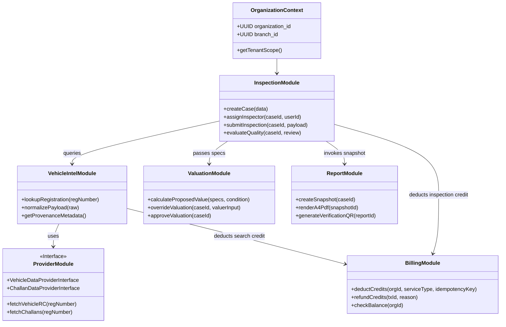
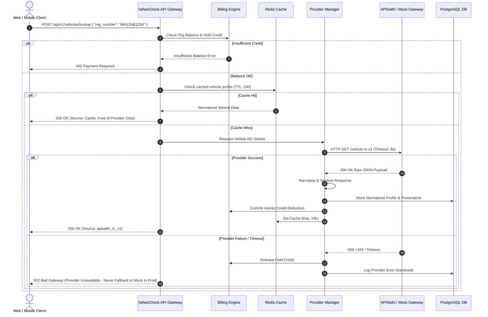
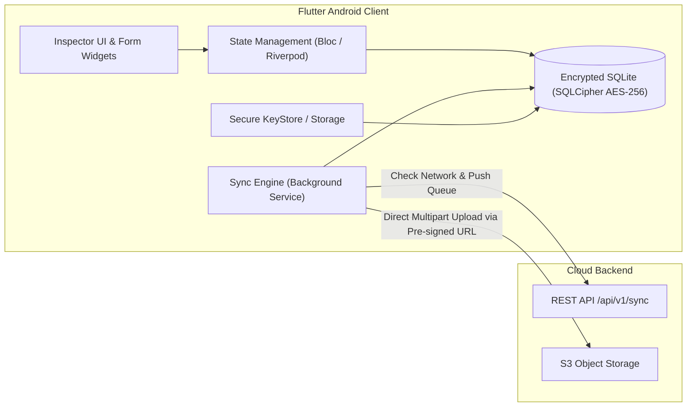
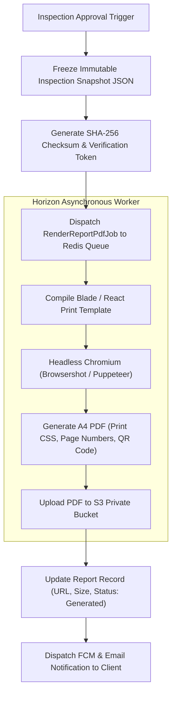

# System Architecture & Technical Design: VahanCheck Enterprise

## 1. Monorepo Repository Structure

The platform repository is structured as a unified monorepo providing clear architectural boundaries between backend services, frontend portals, mobile applications, database migrations, report templates, and shared infrastructure definitions.

```
VAHAAN-INSPECTION/
├── backend/                  # Laravel 11.x Modular Monolith REST API
│   ├── app/
│   │   ├── Modules/          # Independent Domain Modules
│   │   │   ├── Auth/
│   │   │   ├── Organizations/
│   │   │   ├── Permissions/
│   │   │   ├── VehicleIntel/
│   │   │   ├── Challans/
│   │   │   ├── Providers/
│   │   │   ├── Inspections/
│   │   │   ├── Evidence/
│   │   │   ├── Tyres/
│   │   │   ├── Valuation/
│   │   │   ├── Reports/
│   │   │   ├── Clients/
│   │   │   ├── Billing/
│   │   │   ├── Notifications/
│   │   │   ├── Fleet/
│   │   │   └── Auditing/
│   │   ├── Shared/           # Cross-cutting primitives (DTOs, ValueObjects, Exceptions)
│   │   └── Console/
│   ├── config/
│   ├── database/             # Migrations, seeders, factories
│   ├── routes/
│   │   ├── api.php
│   │   └── web.php
│   └── tests/
├── web/                      # Next.js 14+ Web SaaS Application
│   ├── src/
│   │   ├── app/              # App Router pages & layouts
│   │   ├── components/       # UI components (shadcn/ui primitives & domain widgets)
│   │   ├── hooks/            # Custom React hooks (auth, query, sync)
│   │   ├── lib/              # API clients, formatters, validators
│   │   └── types/            # TypeScript interfaces & DTO definitions
│   ├── public/
│   └── tailwind.config.ts
├── mobile/                   # Flutter 3.x Android Application
│   ├── lib/
│   │   ├── core/             # Network, encrypted database, storage, errors
│   │   ├── features/         # Feature packages (auth, cases, inspection, camera, sync)
│   │   └── main.dart
│   ├── test/
│   └── pubspec.yaml
├── database/                 # Central schema DDL, ER diagrams, raw SQL migration dumps
├── mock-api/                 # Standalone Mock API server & deterministic fixtures
├── report-templates/         # HTML/CSS/Blade templates for A4 PDF rendering
├── infrastructure/           # Docker Compose, Nginx, Redis configs, Kubernetes manifests
├── docs/                     # Architecture, specifications, API contracts, guides
├── tests/                    # Integration, contract, and end-to-end test suites
├── .github/                  # CI/CD Workflows (lint, test, build, docker publish)
├── AGENTS.md                 # Agent orchestration & maintenance rules
└── README.md                 # Project getting started guide
```

---

## 2. Laravel Modular Monolith Architecture

The backend is built as a **Modular Monolith** in Laravel 11. Each module encapsulates its own Models, Controllers, Services, Repositories, Events, Listeners, and Requests. Direct cross-module model querying is discouraged; modules communicate via explicit Domain Services, Contracts, or Laravel Events.



### Module Responsibilities:
1. **Auth & Identity**: JWT/Sanctum token lifecycle, device registration, password hashing (Argon2id), session invalidation.
2. **Organizations & Branches**: Tenant boundaries, subscription limits, custom branding (logos, watermarks, disclaimers).
3. **Permissions (RBAC)**: Fine-grained capability checks (`can('inspections.approve')`).
4. **Providers**: Encapsulated third-party drivers (`ApisathiProvider`, `MockProvider`), circuit breaker logic, rate limiting, and HTTP client telemetry.
5. **Vehicle Intelligence**: Normalized schema ingestion, raw payload archiving, provenance tracking, field validation.
6. **Challans**: Fine calculation, status categorization, Parivahan verification links, historical record deduplication.
7. **Inspections**: Dynamic template engine, checkpoint responses, location fencing, workflow state transitions.
8. **Evidence**: Media metadata validation (EXIF, hashes, MIME checks), S3 file upload handling, pre-signed URL generation.
9. **Tyres**: Axle schema mapping, tread-depth grading, condition classification, individual wheel logging.
10. **Valuation**: Depreciation curves, condition penalty matrix, certified valuer adjustments, auditable remark tracking.
11. **Reports**: HTML snapshot freezing, Chromium PDF rendering, cryptographic QR signing, revision history.
12. **Billing**: Atomic wallet operations, double-entry ledger bookkeeping, idempotency control, invoice generation.
13. **Auditing**: Tamper-evident activity logs, IP/User-Agent tracking, PII access logging.

---

## 3. Multi-Tenancy & Tenant Isolation

Tenant isolation is critical for an enterprise platform handling proprietary financial and vehicle data.

### 3.1 Data Layer Isolation
- **Row-Level Tenancy with Global Scopes**: Every tenant entity includes an `organization_id` column indexed with foreign keys. A global Eloquent scope automatically appends `WHERE organization_id = :current_tenant_id` to all select, update, and delete queries.
- **Tenant Context Middleware**: Resolves the tenant from the authenticated user's Sanctum token claims. Any request attempting cross-tenant access without Super-Admin privilege results in a `403 Forbidden` response.

### 3.2 Storage Isolation
- Object storage keys are prefixed by organization ID and case ID:
  `s3://vahan-storage/{organization_id}/inspections/{case_id}/{category}/{filename}.webp`
- Access is strictly governed via short-lived (15 minutes) pre-signed S3 URLs.

### 3.3 Cache & Queue Isolation
- **Redis Cache Prefixes**: All cached keys are prefixed with `tenant:{org_id}:...`.
- **Tenant Queue Routing**: Dedicated high-priority queue channels exist for billing and PDF generation to prevent high-volume tenants from starving shared workers.

---

## 4. API Provider Integration Architecture



### Key Provider Rules:
1. **Mock vs Production Isolation**: In `local` or `testing` environments, `MockProvider` simulates deterministic scenarios. In `production`, `ApisathiProvider` is strictly active.
2. **Circuit Breaker Pattern**: If 5 consecutive requests to the external provider fail within 60 seconds, the circuit opens for 120 seconds, immediately returning `503 Service Unavailable` to conserve API credits and client latency.
3. **Report Watermarking**: When an inspection or vehicle report is derived from mock data, the rendering engine injects an immutable diagonal watermark: `DEMONSTRATION DATA — NOT FOR OFFICIAL USE`.

---

## 5. Offline-First Android Architecture (Flutter)

The field inspector mobile application operates reliably in subterranean parking lots, rural yards, and basements with zero network connectivity.



### Sync Protocol & Durability:
1. **Local Encryption**: All offline drafts, cached vehicle profiles, and inspector notes are encrypted at rest using `SQLCipher` with keys derived from Android Keystore.
2. **Transactional Outbox Queue**: Photo captures and form updates are written to an internal SQLite `sync_outbox` table before network attempts.
3. **Idempotent Sync Operations**: Each sync operation includes an `idempotency_key` (UUID v4) generated by the mobile client. Re-sending identical payloads will not cause duplicate database records or multiple billing transactions.
4. **Resumable Photo Uploads**: Large multi-megabyte inspection photographs are compressed to WebP format on-device, then uploaded directly to pre-signed S3 endpoints with checksum verification (`Content-MD5`).

---

## 6. Document Generation & PDF Engine Architecture

The PDF report engine generates print-ready, high-resolution A4 documents matching commercial surveying and banking requirements.



### Layout & Rendering Standards:
- Standardized A4 Page Dimensions (`210mm x 297mm`) with `12mm` margins.
- Repeated table headers across page splits using CSS `thead { display: table-header-group; }`.
- Deterministic page breaks using `page-break-inside: avoid;` on photo grids and valuation summary cards.
- Embedded high-contrast cryptographic QR code resolving to `https://app.vahancheck.com/verify-report/{report_token}`.
