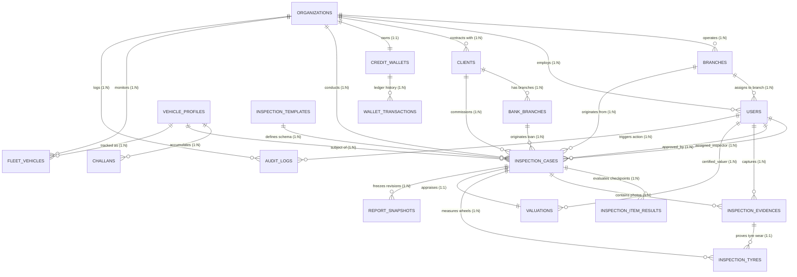

# Database Architecture, ERD & Data Dictionary: VahanCheck Enterprise

## 1. Overview & Data Modeling Directives

The database architecture of VahanCheck Enterprise is built on **PostgreSQL 16/18** and implemented via 16 modular Laravel database migrations. It enforces strict multi-tenant row-level isolation, monetary precision without floating-point inaccuracies, auditable provenance, dynamic inspection template versioning, and immutable report snapshots.

### Core Architectural Invariants Enforced in Schema:
1. **Universal UUID Primary Keys**: Every table utilizes UUID v4 (`$table->uuid('id')->primary()`) to eliminate enumeration vulnerabilities and enable offline mobile record creation without key collisions.
2. **Tenant Scoping**: All tenant-scoped entities include `organization_id NOT NULL REFERENCES organizations(id) ON DELETE CASCADE`.
3. **Monetary Precision in Minor Currency Units**: All financial sums (challan fines, vehicle valuations, repair deductions, ledger balances) are stored as 64-bit integers (`BIGINT` representing Indian Paise, where ₹1.00 = 100 paise). Floating-point (`float`, `double`) types are strictly prohibited.
4. **Immutable Double-Entry Financial Ledger**: `wallet_transactions` records cannot be updated or deleted. Only `created_at` is tracked; standard `updated_at` is disabled.
5. **Dynamic Template Versioning**: `inspection_templates` enforces unique `(vehicle_category, version)`, allowing historical inspection cases to permanently reference the exact template definition under which they were audited.
6. **Immutable Report Snapshots**: `report_snapshots` enforces unique `(inspection_case_id, version)` and stores an immutable JSON representation of the approved inspection state accompanied by a SHA-256 checksum and cryptographic QR verification token.
7. **DPDP Act 2023 Compliance**: Vehicle owner names are masked at storage or display layer (`owner_name_masked`).

---

## 2. Complete Entity-Relationship Diagram (ERD)

---

## 3. Data Dictionary & Table Specifications

### 3.1 `organizations` (Tenant Root)
Primary tenant entity representing an authorized inspection agency, surveyor firm, bank underwriting unit, or fleet enterprise.
- **Migration**: `2026_01_01_000001_create_organizations_table.php`
- **Model**: `App\Models\Organization`

| Column | Type | Nullable | Constraints & Defaults | Description |
| :--- | :--- | :--- | :--- | :--- |
| `id` | `UUID` | No | Primary Key | Universally unique tenant identifier. |
| `name` | `VARCHAR(255)` | No | — | Commercial operating name (e.g. *SpeedCheck Valuers Pvt Ltd*). |
| `legal_name` | `VARCHAR(255)` | Yes | — | Registered corporate legal name for tax invoicing. |
| `slug` | `VARCHAR(100)` | No | UNIQUE | URL-safe routing slug (`speedcheck`). |
| `email` | `VARCHAR(255)` | No | — | Primary billing and administrative contact email. |
| `phone` | `VARCHAR(20)` | No | — | Enterprise contact phone. |
| `gst_number` | `VARCHAR(15)` | Yes | — | Indian Goods and Services Tax Identification Number (GSTIN). |
| `pan_number` | `VARCHAR(10)` | Yes | — | Permanent Account Number (PAN). |
| `logo_url` | `TEXT` | Yes | — | S3 URL to high-resolution branding logo for PDF headers. |
| `report_disclaimer` | `TEXT` | Yes | — | Custom legal liability and certification disclaimer text. |
| `status` | `VARCHAR(30)` | No | Default: `'ACTIVE'` | Tenant status (`ACTIVE`, `SUSPENDED`, `TRIAL`). |
| `settings` | `JSONB` | No | Default: `'{}'` | Tenant configuration parameters (branding, thresholds). |
| `created_at` | `TIMESTAMPTZ`| No | Current Timestamp | Record creation timestamp. |
| `updated_at` | `TIMESTAMPTZ`| No | Current Timestamp | Record modification timestamp. |
| `deleted_at` | `TIMESTAMPTZ`| Yes | — | Soft delete timestamp. |

---

### 3.2 `branches` (Organization Branch Offices)
Operational branches, regional yards, and depot offices operating under a parent organization.
- **Migration**: `2026_01_01_000002_create_branches_table.php`
- **Model**: `App\Models\Branch`

| Column | Type | Nullable | Constraints & Defaults | Description |
| :--- | :--- | :--- | :--- | :--- |
| `id` | `UUID` | No | Primary Key | Branch identifier. |
| `organization_id`| `UUID` | No | FK -> `organizations(id)` ON DELETE CASCADE | Parent tenant identifier. |
| `name` | `VARCHAR(255)` | No | — | Branch name (e.g. *Pune Headquarters*, *Chakan Auto Yard*). |
| `code` | `VARCHAR(50)` | No | — | Internal branch identifier code (`PUN-HQ`, `CHK-02`). |
| `city` | `VARCHAR(100)` | No | — | City of operation. |
| `state` | `VARCHAR(100)` | No | — | State / Union Territory. |
| `pincode` | `VARCHAR(10)` | No | — | Postal postal index number. |
| `address` | `TEXT` | No | — | Physical street address. |
| `is_headquarters`| `BOOLEAN` | No | Default: `FALSE` | Flags main administrative headquarters branch. |
| `created_at` / `updated_at` | `TIMESTAMPTZ` | No | Current Timestamp | Audit timestamps. |

**Indexes & Constraints**:
- `UNIQUE(organization_id, code)`

---

### 3.3 `users` (Identity & RBAC)
User accounts across all roles (Administrators, Managers, Valuers, Field Inspectors, Client Viewers).
- **Migration**: `2026_01_01_000003_create_users_table.php`
- **Model**: `App\Models\User`

| Column | Type | Nullable | Constraints & Defaults | Description |
| :--- | :--- | :--- | :--- | :--- |
| `id` | `UUID` | No | Primary Key | User account identifier. |
| `organization_id`| `UUID` | No | FK -> `organizations(id)` ON DELETE CASCADE | Tenant scoping. |
| `branch_id` | `UUID` | Yes | FK -> `branches(id)` ON DELETE SET NULL | Assigned operating branch. |
| `name` | `VARCHAR(255)` | No | — | Full legal name of user. |
| `email` | `VARCHAR(255)` | No | — | Work email address for authentication. |
| `phone` | `VARCHAR(20)` | No | — | Mobile phone number for SMS and 2FA. |
| `password_hash` | `VARCHAR(255)` | No | — | Argon2id / Bcrypt password hash. |
| `role` | `VARCHAR(50)` | No | Default: `'INSPECTOR'` | Role (`SUPER_ADMIN`, `ORG_ADMIN`, `MANAGER`, `VALUER`, `INSPECTOR`, `CLIENT_VIEWER`). |
| `is_active` | `BOOLEAN` | No | Default: `TRUE` | Account operational status. |
| `device_token` | `TEXT` | Yes | — | Firebase Cloud Messaging (FCM) registration token. |
| `last_login_at` | `TIMESTAMPTZ`| Yes | — | Timestamp of most recent successful authentication. |

**Indexes & Constraints**:
- `UNIQUE(organization_id, email)`

---

### 3.4 `clients` & `bank_branches` (Requesting Institutions)
Commercial banks, NBFCs, pre-owned vehicle dealerships, and fleet clients commissioning inspections.
- **Migration**: `2026_01_01_000006_create_clients_and_bank_branches_table.php`
- **Models**: `App\Models\Client`, `App\Models\BankBranch`

#### Table: `clients`
| Column | Type | Nullable | Constraints & Defaults | Description |
| :--- | :--- | :--- | :--- | :--- |
| `id` | `UUID` | No | Primary Key | Client identifier. |
| `organization_id`| `UUID` | No | FK -> `organizations(id)` ON DELETE CASCADE | Tenant scoping. |
| `name` | `VARCHAR(255)` | No | — | Client institution name (*HDFC Bank Ltd*, *Tata Capital*). |
| `client_type` | `VARCHAR(50)` | No | Default: `'BANK'` | Category (`BANK`, `NBFC`, `DEALER`, `SURVEYOR`, `FLEET_OPERATOR`). |
| `contact_person`| `VARCHAR(255)` | No | — | Primary relationship officer. |
| `email` / `phone` | `VARCHAR` | No | — | Contact coordinates. |
| `pan_number` / `gst_number` | `VARCHAR` | Yes | — | Tax identifiers. |
| `billing_address`| `TEXT` | Yes | — | Corporate billing address. |
| `is_active` | `BOOLEAN` | No | Default: `TRUE` | Active engagement flag. |

#### Table: `bank_branches`
| Column | Type | Nullable | Constraints & Defaults | Description |
| :--- | :--- | :--- | :--- | :--- |
| `id` | `UUID` | No | Primary Key | Bank branch identifier. |
| `client_id` | `UUID` | No | FK -> `clients(id)` ON DELETE CASCADE | Parent client institution. |
| `branch_name` | `VARCHAR(255)` | No | — | Branch name (e.g. *Pune Camp Retail Assets Branch*). |
| `branch_code` | `VARCHAR(50)` | No | — | IFSC / Branch code (`HDFC0000039`). |
| `city` / `state` | `VARCHAR` | No | — | Geographic location. |

---

### 3.5 `vehicle_profiles` (Normalized National VAHAN Registry)
Authoritative normalized vehicle identity, technical specifications, and compliance validities.
- **Migration**: `2026_01_01_000007_create_vehicle_profiles_table.php`
- **Model**: `App\Models\VehicleProfile`

| Column | Type | Nullable | Constraints & Defaults | Description |
| :--- | :--- | :--- | :--- | :--- |
| `id` | `UUID` | No | Primary Key | Vehicle profile identifier. |
| `registration_number` | `VARCHAR(20)` | No | UNIQUE | Official Indian registration number (`MH12AB1234`). |
| `chassis_number` | `VARCHAR(50)` | No | — | Full Chassis / VIN identification number. |
| `engine_number` | `VARCHAR(50)` | No | — | Engine block serial number. |
| `maker_model` | `VARCHAR(255)` | No | — | Combined maker and model designation. |
| `maker_name` / `model_name` | `VARCHAR(100)` | No | — | Normalized vehicle manufacturer and model. |
| `variant_name` | `VARCHAR(100)` | Yes | — | Specific vehicle sub-trim / variant. |
| `vehicle_class` | `VARCHAR(100)` | No | — | Official MoRTH category (*Heavy Goods Vehicle*, *Motor Car*). |
| `body_type` | `VARCHAR(100)` | Yes | — | Body configuration (*TRACTOR COMMERCIAL*, *SALOON*). |
| `fuel_type` | `VARCHAR(50)` | No | — | Fuel source (*DIESEL*, *PETROL*, *CNG*, *ELECTRIC*). |
| `emission_norms` | `VARCHAR(50)` | Yes | — | Emission standard (*BHARAT STAGE VI (BS-VI)*). |
| `seating_capacity` | `INT` | Yes | — | Certified seating capacity. |
| `cubic_capacity` | `INT` | Yes | — | Engine cubic capacity (cc). |
| `unladen_weight_kg` / `gross_vehicle_weight_kg` | `INT` | Yes | — | Tare and Gross Vehicle Weight (GVW) in kilograms. |
| `registration_date` / `manufacturing_date` | `DATE` | Yes | — | Official registry and manufacturing dates. |
| `rto_code` / `rto_name` / `state_code` | `VARCHAR` | No | — | Registering transport authority. |
| `rc_status` | `VARCHAR(50)` | No | Default: `'ACTIVE'` | Registration validity (`ACTIVE`, `EXPIRED`, `CANCELLED`). |
| `ownership_sequence` | `INT` | No | Default: `1` | Number of previous owners (1 = First Owner). |
| `owner_name_masked` | `VARCHAR(255)` | No | — | Masked name complying with DPDP Act 2023 (`M**** L**** LOGISTICS`). |
| `hypothecated` | `BOOLEAN` | No | Default: `FALSE` | Financier lien flag. |
| `financier_name` | `VARCHAR(255)` | Yes | — | Registered bank/NBFC hypothecation entity. |
| `insurance_company` | `VARCHAR(255)` | Yes | — | Registered underwriting insurance provider. |
| `insurance_policy_number` | `VARCHAR(100)` | Yes | — | Policy reference number. |
| `insurance_valid_until` | `DATE` | Yes | — | Insurance expiry date. |
| `fitness_valid_until` | `DATE` | Yes | — | Commercial fitness certificate expiry date. |
| `tax_valid_until` | `DATE` | Yes | — | Road tax validity expiry date. |
| `pucc_valid_until` | `DATE` | Yes | — | Pollution Under Control Certificate (PUCC) expiry date. |
| `national_permit_number` / `valid_until` | `VARCHAR` / `DATE` | Yes | — | Commercial permit credentials. |
| `blacklist_status` | `VARCHAR(50)` | No | Default: `'CLEAN'` | Blacklist status (`CLEAN`, `BLACKLISTED`). |
| `provider_source` | `VARCHAR(50)` | No | — | Provenance source (`apisathi_rc_v1`, `mock_gateway`, `manual`). |
| `is_mock_data` | `BOOLEAN` | No | Default: `FALSE` | Triggers indelible report watermarking. |
| `raw_response` | `JSONB` | Yes | — | Archived raw external provider JSON payload. |
| `provenance_metadata`| `JSONB` | No | Default: `'{}'` | Field-by-field verification status flags. |
| `last_fetched_at` | `TIMESTAMPTZ`| No | Current Timestamp | Timestamp of last provider synchronization. |

**Indexes**:
- `INDEX(registration_number)`
- `INDEX(chassis_number)`
- `INDEX(rc_status)`

---

### 3.6 `challans` (Traffic Violations & Fines)
Traffic violation tickets retrieved from the national eChallan portal.
- **Migration**: `2026_01_01_000008_create_challans_table.php`
- **Model**: `App\Models\Challan`

| Column | Type | Nullable | Constraints & Defaults | Description |
| :--- | :--- | :--- | :--- | :--- |
| `id` | `UUID` | No | Primary Key | Challan record identifier. |
| `vehicle_profile_id` | `UUID` | No | FK -> `vehicle_profiles(id)` ON DELETE CASCADE | Associated vehicle profile. |
| `challan_number` | `VARCHAR(100)` | No | UNIQUE | Official police violation ticket number. |
| `offence_details` | `TEXT` | No | — | Statutory traffic offence description and Motor Vehicle Act section. |
| `offence_date_time` | `TIMESTAMPTZ` | No | — | Date and time violation was recorded. |
| `fine_amount_paise` | `BIGINT` | No | Default: `0` | **Monetary precision**: Fine amount in Indian Paise (e.g. ₹2,000 = `200000`). |
| `state_code` / `rto_name` | `VARCHAR` | No | — | Issuing state police jurisdiction and authority. |
| `challan_status` | `VARCHAR(50)` | No | — | Status (`PENDING`, `DISPOSED`, `COURT_TRANSFERRED`, `CONTESTED`). |
| `court_name` | `VARCHAR(255)` | Yes | — | Judicial magistrate court name if transferred. |
| `payment_date` | `TIMESTAMPTZ` | Yes | — | Settlement date if disposed. |
| `receipt_number` | `VARCHAR(100)` | Yes | — | Settlement receipt confirmation number. |
| `parivahan_url` | `TEXT` | No | Default: `'https://echallan.parivahan.gov.in/'` | Direct authoritative settlement portal URL. |
| `provider_source` | `VARCHAR(50)` | No | — | Gateway source identifier (`apisathi_challan`, `mock_gateway`). |
| `is_mock_data` | `BOOLEAN` | No | Default: `FALSE` | Mock data watermark trigger. |

**Indexes**:
- `INDEX(vehicle_profile_id)`
- `INDEX(challan_status)`
- `INDEX(offence_date_time)`

---

### 3.7 `inspection_templates` (Versioned Checkpoint Schemas)
Configurable, versioned checkpoint definitions ensuring reproducible historical inspections.
- **Migration**: `2026_01_01_000009_create_inspection_templates_table.php`
- **Model**: `App\Models\InspectionTemplate`

| Column | Type | Nullable | Constraints & Defaults | Description |
| :--- | :--- | :--- | :--- | :--- |
| `id` | `UUID` | No | Primary Key | Template identifier. |
| `name` | `VARCHAR(255)` | No | — | Human-readable title (*HCV 3-Axle Truck Dossier Template*). |
| `vehicle_category` | `VARCHAR(50)` | No | — | Category (`COMMERCIAL_HEAVY`, `COMMERCIAL_LIGHT`, `BUS`, `PASSENGER_CAR`, `TWO_WHEELER`, `CONSTRUCTION`). |
| `version` | `INT` | No | Default: `1` | Schema revision integer (`1`, `2`, `3`). |
| `is_active` | `BOOLEAN` | No | Default: `TRUE` | Active template for new cases. |
| `schema_definition`| `JSONB` | No | — | Checkpoints, sections, mandatory rules, and evidence photo slots. |

**Indexes & Constraints**:
- `UNIQUE(vehicle_category, version)`
- `INDEX(vehicle_category, is_active)`

---

### 3.8 `inspection_cases` (Inspection Lifecycle Master)
Core transactional entity tracking a vehicle inspection from initial bank request to final approval.
- **Migration**: `2026_01_01_000010_create_inspection_cases_table.php`
- **Model**: `App\Models\InspectionCase`

| Column | Type | Nullable | Constraints & Defaults | Description |
| :--- | :--- | :--- | :--- | :--- |
| `id` | `UUID` | No | Primary Key | Inspection case identifier. |
| `organization_id`| `UUID` | No | FK -> `organizations(id)` ON DELETE CASCADE | **Tenant Scoping**. |
| `branch_id` | `UUID` | Yes | FK -> `branches(id)` ON DELETE SET NULL | Operating branch. |
| `client_id` | `UUID` | Yes | FK -> `clients(id)` ON DELETE SET NULL | Requesting financial client. |
| `bank_branch_id` | `UUID` | Yes | FK -> `bank_branches(id)` ON DELETE SET NULL | Bank branch originating loan. |
| `loan_reference_number` | `VARCHAR(100)` | Yes | — | Bank loan application / file reference number. |
| `vehicle_profile_id` | `UUID` | No | FK -> `vehicle_profiles(id)` ON DELETE RESTRICT | Target vehicle. |
| `assigned_inspector_id` | `UUID` | Yes | FK -> `users(id)` ON DELETE SET NULL | Field inspector allocated to case. |
| `template_id` | `UUID` | No | FK -> `inspection_templates(id)` ON DELETE RESTRICT | Specific template version utilized. |
| `status` | `VARCHAR(50)` | No | Default: `'DRAFT'` | Workflow state (`DRAFT`, `ASSIGNED`, `IN_PROGRESS`, `SUBMITTED`, `UNDER_REVIEW`, `CORRECTIONS_REQUIRED`, `APPROVED`, `DELIVERED`). |
| `priority` | `VARCHAR(20)` | No | Default: `'MEDIUM'` | Priority level (`LOW`, `MEDIUM`, `HIGH`, `URGENT`). |
| `scheduled_at` | `TIMESTAMPTZ`| Yes | — | Target physical appointment time. |
| `inspection_address` | `TEXT` | No | — | Physical yard / garage address where vehicle is situated. |
| `inspection_latitude` / `longitude` | `DECIMAL(10,7)`| Yes | — | GPS coordinates where inspection occurred. |
| `odometer_reading_km` | `INT` | Yes | — | Physical odometer reading in kilometers. |
| `engine_started` | `BOOLEAN` | Yes | — | Engine starting verification outcome. |
| `road_tested` | `BOOLEAN` | Yes | — | Road test test-drive execution flag. |
| `summary_condition_rating` | `VARCHAR(30)` | Yes | — | Overall vehicle rating (`EXCELLENT`, `GOOD`, `AVERAGE`, `POOR`, `CRITICAL`). |
| `qc_remarks` | `TEXT` | Yes | — | Quality review observations and corrective notices. |
| `submitted_at` | `TIMESTAMPTZ`| Yes | — | Timestamp of field inspector submission. |
| `approved_by` | `UUID` | Yes | FK -> `users(id)` ON DELETE SET NULL | Certified valuer or QC head approving report. |
| `approved_at` | `TIMESTAMPTZ`| Yes | — | Timestamp of formal approval. |

**Indexes**:
- `INDEX(organization_id, status)`
- `INDEX(assigned_inspector_id, status)`
- `INDEX(scheduled_at)`

---

### 3.9 `inspection_item_results` (Checkpoint Findings)
Granular findings for each inspection checkpoint. Untested checkpoints are **never** defaulted to "Pass".
- **Migration**: `2026_01_01_000011_create_inspection_item_results_table.php`
- **Model**: `App\Models\InspectionItemResult`

| Column | Type | Nullable | Constraints & Defaults | Description |
| :--- | :--- | :--- | :--- | :--- |
| `id` | `UUID` | No | Primary Key | Item result identifier. |
| `inspection_case_id` | `UUID` | No | FK -> `inspection_cases(id)` ON DELETE CASCADE | Parent inspection case. |
| `section_key` | `VARCHAR(100)` | No | — | Section key (`cabin_exterior`, `chassis_frame`, `powertrain_mechanical`). |
| `item_key` | `VARCHAR(100)` | No | — | Checkpoint key (`longitudinal_beams`, `chassis_stamping`). |
| `item_label` | `VARCHAR(255)` | No | — | Human-readable checkpoint title. |
| `rating` | `VARCHAR(50)` | No | Default: `'NOT_CHECKED'` | Evaluation rating (`PASS`, `FAIL`, `ATTENTION_REQUIRED`, `NOT_APPLICABLE`, `NOT_CHECKED`). |
| `score` | `INT` | Yes | — | Numeric score (1-5 or 0-100). |
| `remarks` | `TEXT` | Yes | — | Inspector physical observations. |
| `verified_physically`| `BOOLEAN` | No | Default: `FALSE` | Physical in-person verification flag. |

**Indexes & Constraints**:
- `UNIQUE(inspection_case_id, section_key, item_key)`
- `INDEX(inspection_case_id, rating)`

---

### 3.10 `inspection_evidences` (Media & Photographic Proof)
Tamper-evident photographic evidence linked to specific vehicle slots and damage locations.
- **Migration**: `2026_01_01_000012_create_inspection_evidences_table.php`
- **Model**: `App\Models\InspectionEvidence`

| Column | Type | Nullable | Constraints & Defaults | Description |
| :--- | :--- | :--- | :--- | :--- |
| `id` | `UUID` | No | Primary Key | Evidence artifact identifier. |
| `inspection_case_id` | `UUID` | No | FK -> `inspection_cases(id)` ON DELETE CASCADE | Associated inspection case. |
| `category` | `VARCHAR(50)` | No | — | Slot category (`FRONT_45`, `REAR_45`, `ODOMETER`, `ENGINE_BAY`, `CHASSIS_STAMP`, `TYRE`, `DAMAGE`). |
| `s3_key` | `TEXT` | No | — | Partitioned S3 object storage path (`{org_id}/inspections/{case_id}/...`). |
| `file_size_bytes` | `INT` | No | — | Exact binary file size. |
| `mime_type` | `VARCHAR(50)` | No | Default: `'image/webp'` | File MIME type (Strictly WebP/JPEG/PNG). |
| `sha256_hash` | `VARCHAR(64)` | No | — | Cryptographic SHA-256 hash for tamper validation. |
| `latitude` / `longitude` | `DECIMAL(10,7)`| Yes | — | EXIF GPS coordinates embedded at photo capture. |
| `captured_at` | `TIMESTAMPTZ` | No | — | Device timestamp when photo was taken. |
| `inspector_id` | `UUID` | No | FK -> `users(id)` ON DELETE RESTRICT | Inspector who operated the camera. |
| `caption` | `TEXT` | Yes | — | Explanatory note or damage description. |
| `is_damage_proof` | `BOOLEAN` | No | Default: `FALSE` | Explicitly flags damage proof used for repair cost deductions. |

**Indexes**:
- `INDEX(inspection_case_id, category)`

---

### 3.11 `inspection_tyres` (Multi-Axle Wheel Condition)
Detailed physical tyre assessment per wheel position across multi-axle commercial vehicles.
- **Migration**: `2026_01_01_000013_create_inspection_tyres_table.php`
- **Model**: `App\Models\InspectionTyre`

| Column | Type | Nullable | Constraints & Defaults | Description |
| :--- | :--- | :--- | :--- | :--- |
| `id` | `UUID` | No | Primary Key | Tyre record identifier. |
| `inspection_case_id` | `UUID` | No | FK -> `inspection_cases(id)` ON DELETE CASCADE | Associated inspection case. |
| `axle_number` | `INT` | No | Default: `1` | Axle index (1 = Front Steering Axle, 2 = Drive Axle, 3 = Dummy/Tag Axle). |
| `position` | `VARCHAR(50)` | No | — | Wheel position (`FRONT_LEFT`, `FRONT_RIGHT`, `REAR_LEFT_OUTER`, `REAR_LEFT_INNER`, `SPARE`). |
| `brand` | `VARCHAR(100)` | No | — | Tyre manufacturer (*MRF*, *Apollo*, *JK Tyre*, *Bridgestone*). |
| `size_spec` | `VARCHAR(50)` | No | — | Dimension specifications (`295/90 R20`, `195/65 R15`). |
| `tread_depth_mm` | `DECIMAL(4,2)`| No | — | Measured physical tread depth in millimeters. |
| `remaining_life_pct` | `INT` | No | — | Estimated remaining tread life (0% to 100%). |
| `condition` | `VARCHAR(50)` | No | — | Rating (`EXCELLENT`, `GOOD`, `AVERAGE`, `WORN_OUT`, `RETREADED`, `DAMAGED_CUT`). |
| `evidence_id` | `UUID` | Yes | FK -> `inspection_evidences(id)` ON DELETE SET NULL | Cross-reference to dedicated tyre photograph. |
| `remarks` | `TEXT` | Yes | — | Tyre wear observations (uneven wear, sidewall damage). |

**Indexes & Constraints**:
- `UNIQUE(inspection_case_id, position)`
- `INDEX(inspection_case_id, condition)`

---

### 3.12 `valuations` (Professional Vehicle Valuation & Override)
Certified appraisal records with algorithmic calculations and auditable valuer adjustments.
- **Migration**: `2026_01_01_000014_create_valuations_table.php`
- **Model**: `App\Models\Valuation`

| Column | Type | Nullable | Constraints & Defaults | Description |
| :--- | :--- | :--- | :--- | :--- |
| `id` | `UUID` | No | Primary Key | Valuation record identifier. |
| `inspection_case_id` | `UUID` | No | UNIQUE, FK -> `inspection_cases(id)` ON DELETE CASCADE | One-to-one link to inspection case. |
| `valuation_methodology` | `VARCHAR(50)` | No | — | Methodology (`DEPRECIATED_MARKET_VALUE`, `FAIR_MARKET_VALUE`, `DISTRESS_VALUE`). |
| `ex_showroom_price_paise` | `BIGINT` | No | — | Baseline ex-showroom or invoice cost in Paise. |
| `base_depreciated_value_paise`| `BIGINT` | No | — | Value after applying age depreciation schedule. |
| `age_in_months` | `INT` | No | — | Vehicle age calculated in months. |
| `age_depreciation_pct` | `DECIMAL(5,2)`| No | — | Standard depreciation curve percentage applied. |
| `odometer_adjustment_paise` | `BIGINT` | No | Default: `0` | Mileage penalty or bonus in Paise. |
| `condition_deduction_paise` | `BIGINT` | No | Default: `0` | Physical body and structural condition deductions. |
| `estimated_repair_refurbishment_paise` | `BIGINT`| No | Default: `0` | Immediate refurbishment cost deductions. |
| `proposed_fair_market_value_paise` | `BIGINT` | No | — | Proposed Fair Market Value (FMV) in Paise. |
| `proposed_distress_value_paise` | `BIGINT` | No | — | Proposed Forced Sale / Distress Value in Paise. |
| `valuer_override_applied` | `BOOLEAN` | No | Default: `FALSE` | Flag indicating certified valuer manual override. |
| `override_fair_market_value_paise` | `BIGINT`| Yes | — | Overridden Fair Market Value in Paise. |
| `override_distress_value_paise` | `BIGINT` | Yes | — | Overridden Distress Value in Paise. |
| `override_justification` | `TEXT` | Yes | — | Mandatory written explanation justifying override. |
| `valuer_id` | `UUID` | No | FK -> `users(id)` ON DELETE RESTRICT | Authorized certified valuer account ID. |
| `certified_valuer_remarks`| `TEXT` | No | — | Professional valuer certification remarks and caveats. |
| `approved_at` | `TIMESTAMPTZ` | No | Current Timestamp | Formal valuation approval timestamp. |

**Indexes**:
- `INDEX(inspection_case_id, valuer_id)`

---

### 3.13 `report_snapshots` (Immutable Report Snapshots)
Frozen, cryptographically hashed inspection dossier snapshots with QR verification tokens.
- **Migration**: `2026_01_01_000015_create_report_snapshots_table.php`
- **Model**: `App\Models\ReportSnapshot`

| Column | Type | Nullable | Constraints & Defaults | Description |
| :--- | :--- | :--- | :--- | :--- |
| `id` | `UUID` | No | Primary Key | Snapshot record identifier. |
| `inspection_case_id` | `UUID` | No | FK -> `inspection_cases(id)` ON DELETE CASCADE | Associated inspection case. |
| `version` | `VARCHAR(20)` | No | Default: `'1.0'` | Dossier version string (`1.0`, `1.1`, `2.0`). |
| `verification_token` | `VARCHAR(64)` | No | UNIQUE | Cryptographic token embedded in public verification QR code. |
| `snapshot_data` | `JSONB` | No | — | Complete immutable JSON state of all vehicle, inspection, and valuation attributes. |
| `sha256_checksum` | `VARCHAR(64)` | No | — | Cryptographic SHA-256 hash of `snapshot_data`. |
| `pdf_s3_key` | `TEXT` | Yes | — | Storage key of rendered A4 PDF document. |
| `pdf_size_bytes` | `INT` | Yes | — | Rendered PDF file size in bytes. |
| `page_count` | `INT` | Yes | — | Exact rendered A4 page count. |
| `is_mock_watermarked` | `BOOLEAN` | No | Default: `FALSE` | Flags indelible watermark requirement. |
| `rendered_at` | `TIMESTAMPTZ` | Yes | — | Timestamp when PDF rendering completed. |

**Indexes & Constraints**:
- `UNIQUE(inspection_case_id, version)`
- `INDEX(verification_token)`

---

### 3.14 `credit_wallets` & `wallet_transactions` (Billing & Immutable Ledgers)
Multi-tenant billing wallet with double-entry immutable transaction ledger.
- **Migration**: `2026_01_01_000004_create_credit_wallets_and_ledger_tables.php`
- **Models**: `App\Models\CreditWallet`, `App\Models\WalletTransaction`

#### Table: `credit_wallets`
| Column | Type | Nullable | Constraints & Defaults | Description |
| :--- | :--- | :--- | :--- | :--- |
| `id` | `UUID` | No | Primary Key | Wallet identifier. |
| `organization_id`| `UUID` | No | UNIQUE, FK -> `organizations(id)` ON DELETE CASCADE | One-to-one tenant ownership. |
| `balance_credits`| `INT` | No | Default: `0` | Current credit balance. |
| `low_balance_threshold`| `INT`| No | Default: `50` | Low balance trigger threshold. |
| `auto_recharge_enabled`| `BOOLEAN`| No | Default: `FALSE` | Automated recharge flag. |

#### Table: `wallet_transactions` (Immutable Ledger)
| Column | Type | Nullable | Constraints & Defaults | Description |
| :--- | :--- | :--- | :--- | :--- |
| `id` | `UUID` | No | Primary Key | Transaction identifier. |
| `credit_wallet_id`| `UUID` | No | FK -> `credit_wallets(id)` ON DELETE CASCADE | Associated wallet. |
| `transaction_type`| `VARCHAR(50)`| No | — | Type (`CREDIT_TOPUP`, `RC_LOOKUP_DEDUCTION`, `CHALLAN_LOOKUP_DEDUCTION`, `INSPECTION_DEDUCTION`, `REFUND`). |
| `credits_amount` | `INT` | No | — | Delta credit amount (+ for top-up, - for deduction). |
| `balance_after` | `INT` | No | — | Atomic balance post-transaction. |
| `idempotency_key`| `VARCHAR(100)`| No | UNIQUE | Client-supplied key preventing duplicate billing. |
| `reference_type` / `reference_id` | `VARCHAR` / `UUID` | Yes | — | Polymorphic entity link. |
| `description` | `TEXT` | No | — | Auditable transaction description. |
| `created_at` | `TIMESTAMPTZ` | No | Current Timestamp | Immutable creation timestamp (No `updated_at`). |

---

### 3.15 `fleet_vehicles` (Fleet Compliance & Expiry Watch)
Commercial fleet tracking registry monitoring document renewal dates.
- **Migration**: `2026_01_01_000016_create_fleet_vehicles_table.php`
- **Model**: `App\Models\FleetVehicle`

| Column | Type | Nullable | Constraints & Defaults | Description |
| :--- | :--- | :--- | :--- | :--- |
| `id` | `UUID` | No | Primary Key | Fleet vehicle identifier. |
| `organization_id`| `UUID` | No | FK -> `organizations(id)` ON DELETE CASCADE | Tenant scoping. |
| `vehicle_profile_id`| `UUID` | No | FK -> `vehicle_profiles(id)` ON DELETE CASCADE | Tracked vehicle profile. |
| `fleet_unit_number` | `VARCHAR(100)`| Yes | — | Custom internal fleet unit code (e.g. *FLEET-TRK-042*). |
| `assigned_driver_name` / `phone` | `VARCHAR` | Yes | — | Primary driver details. |
| `depot_location` | `VARCHAR(255)` | Yes | — | Base operating depot. |
| `insurance_alert_days_before` / `fitness_alert_days_before` | `INT` | No | Default: `30` | Lead days before expiry alert is fired. |
| `is_active` | `BOOLEAN` | No | Default: `TRUE` | Active fleet status. |

**Indexes & Constraints**:
- `UNIQUE(organization_id, vehicle_profile_id)`
- `INDEX(organization_id, is_active)`

---

### 3.16 `audit_logs` (System-Wide Security Audit Trail)
Append-only tamper-evident security audit trail tracking critical mutations, valuation overrides, and PII inquiries.
- **Migration**: `2026_01_01_000005_create_audit_logs_table.php`
- **Model**: `App\Models\AuditLog`

| Column | Type | Nullable | Constraints & Defaults | Description |
| :--- | :--- | :--- | :--- | :--- |
| `id` | `UUID` | No | Primary Key | Audit record identifier. |
| `organization_id`| `UUID` | Yes | FK -> `organizations(id)` ON DELETE SET NULL | Tenant context. |
| `user_id` | `UUID` | Yes | FK -> `users(id)` ON DELETE SET NULL | Acting user. |
| `action` | `VARCHAR(100)` | No | — | Action key (`USER_LOGIN`, `RC_LOOKUP`, `VALUATION_OVERRIDDEN`, `REPORT_GENERATED`). |
| `entity_type` / `entity_id` | `VARCHAR` / `UUID` | Yes | — | Target entity reference. |
| `old_values` / `new_values` | `JSONB` | Yes | — | State diff delta before and after mutation. |
| `ip_address` | `INET` | Yes | — | Client IPv4 or IPv6 address. |
| `user_agent` | `TEXT` | Yes | — | Client browser / device user-agent string. |
| `created_at` | `TIMESTAMPTZ` | No | Current Timestamp | Immutable event timestamp. |

**Indexes**:
- `INDEX(organization_id, created_at DESC)`
- `INDEX(action)`
