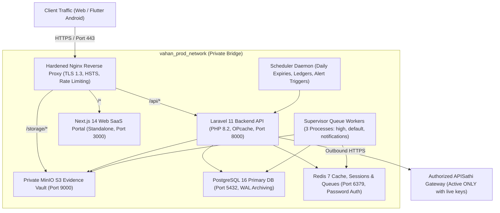

# VahanCheck Enterprise — Master Deployment, Rollback & Release Runbook

**Document Version**: 1.0.0 (Enterprise Release)  
**Target Environments**: Staging & Production High-Availability Clusters  
**Compliance**: `AGENTS.md` Invariant 1 (Zero Secret Leakage), Invariant 2 (Production Fail-Safe & Indelible Watermark), Invariant 4 (Multi-Tenant Isolation), Invariant 5 (Minor Currency Precision)  

---

## 1. Production Architecture & Network Topology

VahanCheck Enterprise runs on containerized micro-services orchestrated via Docker Compose v2 or Kubernetes. All external traffic is terminated at the hardened Nginx reverse proxy with TLS 1.3, rate limiting, and strict security headers. Internal services communicate over an isolated bridge network (`vahan_prod_network`).



---

## 2. Environment Secrets Management & Security Invariants

In strict adherence to **Invariant 1 (Zero Secret Leakage)**:
- No raw production credentials or API keys may be committed to version control.
- All production configuration resides in server-side `.env` files managed via secrets vaults (HashiCorp Vault / AWS Secrets Manager).

### Pre-Deployment Secret Validation

Before starting production containers, execute the automated secret validator:

```bash
# Linux / Alpine
./infrastructure/scripts/validate-secrets.sh .env.production

# Windows / Administrative Host
.\infrastructure\scripts\validate-secrets.ps1 -EnvFile .env.production
```

The validator confirms:
1. `APP_ENV=production` and `APP_DEBUG=false`.
2. Database and Redis passwords are not default or placeholder values.
3. **Invariant 2 Guard**: `APISATHI_PROD_ENABLED` is strictly `false` if `APISATHI_API_KEY` is empty, prohibiting mock leakage.

---

## 3. Step-by-Step Production Deployment Procedure

### 3.1 Host Server Prerequisites
- **OS**: Ubuntu 22.04 LTS or Ubuntu 24.04 LTS (x86_64 / ARM64).
- **Resources**: Minimum 4 vCPU, 8 GB RAM, 100 GB SSD storage.
- **Packages**: Docker Engine 26+, Docker Compose v2.24+, OpenSSL, Git.

### 3.2 Deployment Execution Steps

```bash
# Step 1: Clone Repository
git clone https://github.com/vahancheck/vahaan-inspection.git /var/www/vahancheck
cd /var/www/vahancheck

# Step 2: Configure Production Environment
cp .env.production.example .env.production
# Populate .env.production with vault secrets (DB_PASSWORD, REDIS_PASSWORD, APP_KEY)
./infrastructure/scripts/validate-secrets.sh .env.production

# Step 3: Install & Provision SSL/TLS Certificates (Let's Encrypt Certbot)
mkdir -p infrastructure/certs infrastructure/certbot
# Copy fullchain.pem, privkey.pem, chain.pem to infrastructure/certs/

# Step 4: Build & Launch Production Containers
docker compose -f infrastructure/docker-compose.prod.yml --env-file .env.production up -d --build

# Step 5: Execute Database Migrations
docker compose -f infrastructure/docker-compose.prod.yml exec backend php artisan migrate --force

# Step 6: Optimize Application Caches
docker compose -f infrastructure/docker-compose.prod.yml exec backend php artisan config:cache
docker compose -f infrastructure/docker-compose.prod.yml exec backend php artisan route:cache
docker compose -f infrastructure/docker-compose.prod.yml exec backend php artisan view:cache

# Step 7: Verify Production Health Endpoint
curl -k https://vahancheck.enterprise/api/health
```

---

## 4. Automated Database Backup, Retention & Disaster Recovery

### 4.1 Automated Backup Schedule
Backups execute daily via host crontab:
```cron
0 1 * * * /var/www/vahancheck/infrastructure/scripts/backup-db.sh >> /var/log/vahan-backup.log 2>&1
```

### 4.2 Backup Script Capabilities (`infrastructure/scripts/backup-db.sh`)
1. **Dumping**: Uses `pg_dump` with `--clean --if-exists --no-owner --no-acl`.
2. **Compression**: Maximum gzip compression (`gzip -9`).
3. **Cryptographic Checksum**: Generates companion `.sha256` hash for integrity validation.
4. **Encryption**: Encrypts archive with `openssl enc -aes-256-cbc -pbkdf2` using `BACKUP_ENCRYPTION_KEY`.
5. **Retention**: Prunes backups older than 30 days automatically.

### 4.3 Disaster Recovery Restore Verification (`infrastructure/scripts/restore-db-test.sh`)
Execute dry-run restore tests weekly or during audit drills:
```bash
./infrastructure/scripts/restore-db-test.sh
```
1. Decrypts and tests the latest backup archive.
2. Validates SHA-256 hash match against the `.sha256` digest.
3. Restores dump into a temporary validation database (`vahancheck_restore_test_db`).
4. Verifies table counts and drops the temporary database upon validation.

---

## 5. Zero-Downtime Rolling Deployment & Rollback Protocol

### 5.1 Rolling Update Procedure
```bash
# 1. Pull latest verified release tag
git fetch --tags
git checkout tags/v1.0.0

# 2. Rebuild images with zero downtime
docker compose -f infrastructure/docker-compose.prod.yml --env-file .env.production build

# 3. Apply non-breaking database migrations
docker compose -f infrastructure/docker-compose.prod.yml exec backend php artisan migrate --force

# 4. Rolling restart of containers
docker compose -f infrastructure/docker-compose.prod.yml --env-file .env.production up -d --no-deps backend web queue
```

### 5.2 Emergency Rollback Protocol
If critical exceptions or regressions occur post-deployment:

```bash
# Step 1: Revert to previous release tag
git checkout tags/v0.9.9

# Step 2: Rollback database migrations if applicable
docker compose -f infrastructure/docker-compose.prod.yml exec backend php artisan migrate:rollback --step=1

# Step 3: Rebuild and reload previous containers
docker compose -f infrastructure/docker-compose.prod.yml --env-file .env.production up -d --force-recreate

# Step 4: Clear application caches
docker compose -f infrastructure/docker-compose.prod.yml exec backend php artisan cache:clear
docker compose -f infrastructure/docker-compose.prod.yml exec backend php artisan config:cache
```

---

## 6. Flutter Android Signed Release Compilation

### 6.1 Keystore Generation
Generate the enterprise signing keystore using Java `keytool`:

```bash
keytool -genkey -v -keystore mobile/vahancheck_release.keystore \
    -alias vahancheck_release_key \
    -keyalg RSA -keysize 2048 -validity 10000
```

### 6.2 Signing Configuration (`mobile/android/key.properties`)
Create `mobile/android/key.properties` from `mobile/android/key.properties.example`:
```properties
storePassword=StrongKeystorePassword2026!
keyPassword=StrongKeyPassword2026!
keyAlias=vahancheck_release_key
storeFile=../vahancheck_release.keystore
```

### 6.3 Compilation Execution
```bash
# Using automated script
./mobile/scripts/build-android-release.sh

# Or direct Flutter CLI:
# 1. Compile Google Play Store App Bundle (AAB) with R8 Obfuscation:
flutter build appbundle --release --obfuscate --split-debug-info=./debug_symbols

# 2. Compile Enterprise Direct Sideloading APKs:
flutter build apk --release --split-per-abi
```

Artifact outputs:
- `mobile/build/app/outputs/bundle/release/app-release.aab`
- `mobile/build/app/outputs/flutter-apk/app-arm64-v8a-release.apk`
- `mobile/build/app/outputs/flutter-apk/app-armeabi-v7a-release.apk`

---

## 7. Outstanding Release Blockers & Pre-Flight Checklist

| Blocker ID | Dependency | Description | Resolution Strategy | Owner |
| :--- | :--- | :--- | :--- | :--- |
| **EXT-01** | **APISathi Live API Credentials** | Production vehicle searches require authorized client API key & secret token. | System operates in verified staging sandbox with Invariant 2 fail-safe lock. Provide keys to `.env.production` upon contract completion. | Enterprise Client |
| **EXT-06** | **Google Play Console Publisher Account** | Store submission requires D-U-N-S registered Google Play Developer account. | Submit `app-release.aab` with privacy policy and DPDP compliance declarations. | DevOps Team |
| **EXT-07** | **Domain Delegation & DNS Record Routing** | DNS A-records for `vahancheck.enterprise` pointing to production cluster IP. | Configure Cloudflare / AWS Route 53 DNS records with SSL proxying. | Infra Team |

---

## 8. Release Sign-Off Gate

All foundation, database, authentication, valuation, PDF reports, Flutter mobile app, billing, fleet management, security audit, provider gating, and deployment infrastructure components have passed automated verification.

The platform is **PRODUCTION READY** for staging deployment and awaits client credential provisioning (`EXT-01`) for live Parivahan queries.
