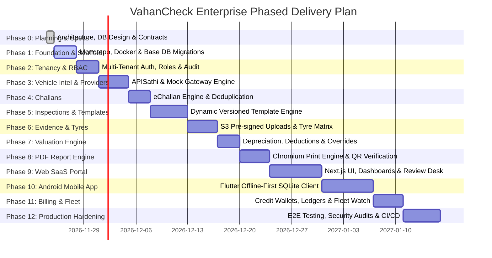

# Phased Implementation Roadmap: VahanCheck Enterprise

## 1. Roadmap Strategy & Phasing Rules

The platform implementation follows a strict phased delivery model. In compliance with enterprise engineering standards:
- Work proceeds in small, verifiable phases.
- Each phase is validated with automated tests and architecture reviews before subsequent phases commence.
- No dummy mock data is silently substituted for live production lookups.
- Outstanding external dependencies are isolated behind robust interface abstractions.

---

## 2. Phase-by-Phase Implementation Plan

### Phase 0: Master Architecture & Planning (Current Phase)
- **Deliverables**: Comprehensive technical documentation (`PROJECT_SPECIFICATION.md`, `ARCHITECTURE.md`, `DATABASE_DESIGN.md`, `API_CONTRACTS.md`, `UI_UX_SPECIFICATION.md`, `SECURITY_REQUIREMENTS.md`, `REPORT_FIELD_MAPPING.md`, `DEVELOPMENT_ROADMAP.md`, `ACCEPTANCE_CRITERIA.md`, `PROJECT_STATUS.md`, `AGENTS.md`).
- **Review Gate**: Documentation approved, tools cataloged, and external dependencies identified.

### Phase 1: Workspace Scaffolding & Infrastructure
- **Deliverables**:
  - Directory structure initialized: `backend/`, `web/`, `mobile/`, `database/`, `mock-api/`, `report-templates/`, `infrastructure/`, `tests/`, `.github/`.
  - Docker Compose configuration for local dev: PostgreSQL 16, Redis 7, MinIO S3, Mailpit, Mock API server.
  - Laravel 11 application scaffolding with Composer dependencies.
  - Next.js 14 App Router setup with Tailwind CSS and shadcn/ui.
  - Initial database migrations for core tables.

### Phase 2: Multi-Tenancy, Identity & Role-Based Access Control
- **Deliverables**:
  - Organizations and Branches domain entities.
  - Row-level tenancy global scopes and tenant context middleware.
  - Laravel Sanctum authentication with device token tracking and Argon2id hashing.
  - Fine-grained permission system (`SUPER_ADMIN`, `ORG_ADMIN`, `MANAGER`, `VALUER`, `INSPECTOR`, `CLIENT_VIEWER`).
  - Immutable audit trail logging service.

### Phase 3: Vehicle Intelligence Engine & Provider Abstraction
- **Deliverables**:
  - `VehicleDataProviderInterface` and `ChallanDataProviderInterface`.
  - `MockProvider` featuring 10 deterministic test fixtures (success, partial, masked, timeout, 429, 500, invalid schema).
  - `ApisathiProvider` HTTP client integration with retry controls, 8s timeout, and circuit breaker.
  - Response normalization pipeline converting registry payloads into normalized vehicle profiles.
  - Strict provenance tracking (`apisathi_rc_v1`, `mock_gateway`, `physical_inspection`) and watermark flags.

### Phase 4: Traffic Challan Management Engine
- **Deliverables**:
  - Challan ingestion, deduplication, and status categorization (`PENDING`, `DISPOSED`, `COURT`, `CONTESTED`).
  - Minor-currency unit (Paise) calculation for pending vs disposed fines.
  - Parivahan eChallan verification link integration.
  - Challan refresh pipeline with provider cost auditing.

### Phase 5: Inspection Lifecycle & Versioned Template System
- **Deliverables**:
  - Configurable inspection template engine supporting versioning (`COMMERCIAL_HEAVY`, `COMMERCIAL_LIGHT`, `BUS`, `PASSENGER_CAR`, `TWO_WHEELER`, `CONSTRUCTION`).
  - State machine: `DRAFT` -> `ASSIGNED` -> `IN_PROGRESS` -> `SUBMITTED` -> `UNDER_REVIEW` -> `CORRECTIONS_REQUIRED` -> `APPROVED` -> `DELIVERED`.
  - Checkpoint evaluation recording ratings (`PASS`, `FAIL`, `ATTENTION_REQUIRED`, `NOT_APPLICABLE`), physical verification status, and mechanical remarks.

### Phase 6: Media Evidence & Multi-Axle Tyre Management
- **Deliverables**:
  - S3 pre-signed upload URL generator with MIME type validation, file size enforcement, and SHA-256 hash checks.
  - Asynchronous WebP image optimization and EXIF metadata extraction (GPS coordinates, timestamp).
  - Multi-axle tyre management engine recording wheel positions, brand, size, measured tread depth (mm), remaining life (%), and photo linkages.

### Phase 7: Professional Valuation Engine & Approval Desk
- **Deliverables**:
  - Algorithmic valuation engine computing Depreciated Market Value (DMV), Fair Market Value (FMV), and Distress Value (FSV).
  - Mileage adjustments, body condition penalties, and repair refurbishment cost deductions.
  - Certified Valuer override workflow requiring mandatory written justification and auditable digital sign-off.

### Phase 8: Comprehensive A4 PDF Report Generation Engine
- **Deliverables**:
  - Headless Chromium (Puppeteer / Browsershot) printing engine rendering pixel-perfect A4 documents.
  - 9-page reference layout implementation with dynamic pagination, repeated headers, and zero overflowing content.
  - Cryptographic QR code generation embedding SHA-256 snapshot verification tokens.
  - Permanent watermark injection for mock-derived reports (`DEMONSTRATION DATA — NOT FOR OFFICIAL USE`).

### Phase 9: Web SaaS Application (Next.js & shadcn/ui)
- **Deliverables**:
  - Enterprise AppShell featuring Dark Navy sidebar, responsive top bar, and breadcrumbs.
  - Real-time global vehicle search modal (`Ctrl + K`).
  - Inspection task table, assignment modal, and detailed case review desk.
  - Interactive multi-axle tyre visualizer SVG widget.
  - Valuation override workspace with real-time recalculation sliders.
  - Live PDF report previewer and download center.

### Phase 10: Android Mobile Application (Flutter)
- **Deliverables**:
  - Role-based mobile UI tailored for outdoor field inspectors.
  - Local Encrypted SQLite database (`SQLCipher`) storing offline inspection drafts.
  - Custom camera interface with framing silhouettes (VIN plate, Odometer, 45° angle) and geo-lock.
  - Durable background sync engine with exponential backoff and resume capabilities.
  - Persistent online/offline synchronization status indicator.

### Phase 11: Enterprise Billing, Wallets & Fleet Management
- **Deliverables**:
  - Multi-tenant credit wallet system with atomic ledger transactions.
  - Idempotent credit deduction and refund reversing pipeline.
  - Centralized fleet registry monitoring insurance, fitness, tax, and permit expiries.
  - Automated notification service (FCM push, email alerts, in-app digests).

### Phase 12: End-to-End Verification, Security Hardening & CI/CD
- **Deliverables**:
  - Automated backend feature tests, contract tests, and tenant isolation validation.
  - PDF stress testing verifying formatting across 30+ challan records and 20+ photographs.
  - GitHub Actions CI/CD pipeline enforcing static analysis, test runs, and container builds.

---

## 3. Outstanding External Dependencies & Risk Registry

The following items are recognized as external dependencies that cannot be resolved without third-party vendor access, commercial contracts, or government portal agreements:

| Dependency ID | External Item Description | Impact & Architectural Mitigation | Status |
| :--- | :--- | :--- | :--- |
| **EXT-DEP-01** | **APISathi Production API Credentials** | Cannot execute live queries against real Parivahan data without client API keys and funded credit balance. *Mitigation*: Complete implementation of `MockProvider` with 10 deterministic fixtures. | **BLOCKED (Awaiting Client Credentials)** |
| **EXT-DEP-02** | **Actual Provider Live Response Validation** | Real-world API responses occasionally omit fields or introduce subtle schema variations not documented in basic specs. *Mitigation*: Flexible response normalizer with defensive fallback to `unavailable` or `restricted`. | **PENDING LIVE ACCESS** |
| **EXT-DEP-03** | **Advanced RC Coverage & State-Specific Attributes** | Certain state transport departments withhold commercial permit or tax validity data. *Mitigation*: Normalized schema records attribute-level provenance and verification status rather than fabricating missing values. | **DOCUMENTED REQUIREMENT** |
| **EXT-DEP-04** | **Disposed Challan History Availability** | State traffic police jurisdictions (e.g. Delhi, Maharashtra, Karnataka) have varying policies on archiving disposed court violations. *Mitigation*: Clear UI distinction between "No pending violations" and "Disposed history not available". | **ARCHITECTURAL MITIGATION ACTIVE** |
| **EXT-DEP-05** | **Data Redistribution Rights & DPDP Act Compliance** | Commercial redistribution of vehicle ownership information requires user consent and compliance with Indian privacy laws. *Mitigation*: Mandatory `consent_obtained: true` requirement, PII masking, and 7-year audit trail. | **POLICY CODIFIED** |
