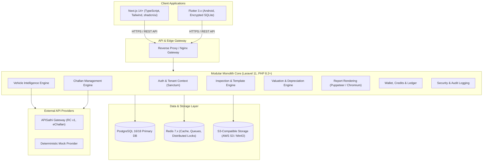

# Project Specification: Vehicle Intelligence & Inspection Management Platform (VahanCheck Enterprise)

## 1. Executive Summary & Vision

The **Vehicle Intelligence & Inspection Management Platform (VahanCheck Enterprise)** is a multi-tenant, cloud-native Software-as-a-Service (SaaS) and mobile ecosystem engineered for the Indian automotive, financial, insurance, and fleet operations industries. 

The platform bridges real-time national vehicle registry intelligence (VAHAN), traffic police violation records (eChallan), and physical ground inspection workflows into a unified, tamper-evident, auditable digital workflow. It serves banks, Non-Banking Financial Companies (NBFCs), vehicle valuation agencies, insurance surveyors, pre-owned vehicle dealerships, and logistics fleet operators.

---

## 2. Key Stakeholders & Target User Personas

| Persona | Primary Needs & Responsibilities | Key Touchpoints |
| :--- | :--- | :--- |
| **Bank / NBFC Underwriter** | Verifies asset hypothecation, blacklisting, RC authenticity, real-time challan liability, and professional valuation before loan disbursement. | Web Portal (Case Review, Valuation Approval, PDF Download) |
| **Surveyor / Valuer Head** | Configures inspection templates, assigns inspection tasks to field personnel, reviews structural evidence, and approves certified valuation reports. | Web Portal (QC Console, Valuation Override, Digital Sign-off) |
| **Field Vehicle Inspector** | Travels to vehicle locations, conducts physical checks across 80+ checkpoints, inspects tyres, captures geotagged/timestamped photographs, and logs observations offline. | Android Mobile App (Offline Drafts, Camera, Sync Queue) |
| **Fleet Manager** | Monitors vehicle health, registration renewals, fitness/PUCC expiries, and tracks pending traffic challans across hundreds of commercial vehicles. | Web Portal (Fleet Registry, Bulk Verification, Expiry Alerts) |
| **Platform Administrator** | Manages multi-tenant organizations, branch licensing, billing wallets, API gateway providers, system health, and compliance audit logs. | Web Super-Admin Console |

---

## 3. Technology Stack & Runtime Architecture

The technology stack is selected for enterprise resilience, long-term support (LTS), strict typing, high throughput, and seamless offline-first mobile operations.

### Detailed Component Specifications

1. **Central Backend**:
   - **Framework**: Laravel 11.x on PHP 8.2+
   - **Architecture**: Modular Monolith with strict boundary encapsulation.
   - **Authentication**: Laravel Sanctum with cryptographically signed, short-lived tokens and device binding.
   - **Queue System**: Redis queue workers managed via Laravel Horizon for asynchronous jobs (report rendering, photo watermarking, bulk verification, webhook processing).
   - **Task Scheduler**: Laravel Scheduler for recurring fleet audit scans, expiry alerts, and provider quota reconciliation.

2. **Web Application**:
   - **Framework**: Next.js 14+ (App Router) with TypeScript 5.x.
   - **UI Engine**: Tailwind CSS 3.4+ and Radix UI / shadcn/ui component library.
   - **Design Language**: Enterprise modern styling — Dark Navy sidebar (`#0F172A` / `#1E293B`), Clean White/Slate background (`#F8FAFC`), Vibrant Blue primary actions (`#2563EB`), Teal success (`#0D9488`), Amber warnings (`#D97706`), Crimson alerts (`#DC2626`).
   - **State Management**: TanStack Query v5 (React Query) for server-state caching and optimistic UI updates.

3. **Android Application**:
   - **Framework**: Flutter 3.x (Dart 3.x) targeting Android SDK 26 to 34+.
   - **Local Storage**: Encrypted SQLite (`sqflite_sqlcipher`) leveraging AES-256 local database encryption.
   - **Offline Synchronization**: Durable transactional sync queue with exponential backoff and resume capabilities.
   - **Camera & Hardware**: Direct Camera2 integration with automated metadata capture (EXIF GPS latitude, longitude, altitude, timestamp, device orientation).

4. **Database & Storage**:
   - **Primary Relational Store**: PostgreSQL 16/18.
   - **In-Memory Store**: Redis 7.x for caching, rate limiting, distributed locking (`Redlock`), and queue pipelines.
   - **Object Storage**: S3-compatible private bucket (AWS S3 or self-hosted MinIO) with private-by-default access and time-limited pre-signed URL generation.

5. **Document Rendering Engine**:
   - **Engine**: Headless Chromium orchestrated via Node.js Puppeteer / Laravel Browsershot.
   - **Layout**: Pixel-accurate print-friendly A4 portrait geometry with dynamic page numbering, repeated table headers, and strict page-break control.

---

## 4. High-Level System Scope & Core Modules

### 4.1 Authentication & Multi-Tenancy Module
- Multi-tier tenant model: **Platform Operator -> Organization (Subscriber) -> Branches -> Users**.
- Row-Level Isolation: Every tenant-scoped table strictly includes `organization_id` enforced via global query scopes and tenant middleware.
- Role-Based Access Control (RBAC): Fine-grained granular permissions (e.g., `inspections.create`, `valuation.approve`, `billing.view`).

### 4.2 API Provider Integration Abstraction
- Unified abstraction layer: `VehicleDataProviderInterface` and `ChallanDataProviderInterface`.
- Two runtime drivers: `ApisathiProvider` (production REST client) and `MockProvider` (deterministic fixture driver).
- Robust resilience controls: Circuit breaker, timeout enforcement (max 8s per lookup), retry backoff, provider cost logging, and response payload sanitization.
- **Fail-safe Rule**: Provider failures or timeouts are never translated to "clean record" or "no challans". Reports derived from mock data must carry clear watermark `DEMONSTRATION DATA — NOT FOR OFFICIAL USE`.

### 4.3 Vehicle Intelligence Engine
- Ingestion and normalization of Indian vehicle registration records (RC).
- Strict provenance tracking for every attribute: `source` (`apisathi_rc_v1`, `user_input`, `physical_inspection`) and `verification_status` (`unavailable`, `restricted`, `not_checked`, `not_applicable`, `provider_reported`, `physically_verified`).
- Coverage includes: Identification (Chassis/Engine), Vehicle Specs, Registration Details, Hypothecation/Financier details, Commercial Permits, Insurance, Fitness, Emission (PUCC), and Blacklist status.

### 4.4 Traffic Challan Management
- Comprehensive retrieval of pending, court-referred, contested, and disposed challans.
- Storage in minor currency units (paise) or precise decimals to eliminate floating-point inaccuracies.
- Direct redirection link to the official Parivahan eChallan portal (`https://echallan.parivahan.gov.in/`). Absolute avoidance of unofficial payment collections.

### 4.5 Vehicle Inspection & Template System
- Lifecycle states: `Draft` -> `Assigned` -> `In_Progress` -> `Submitted` -> `Under_Review` -> `Corrections_Required` -> `Approved` -> `Delivered`.
- Versioned templates tailored for:
  - Commercial Vehicles (HCV, MCV, LCV)
  - Passenger Cars (Hatchback, Sedan, SUV, EV)
  - Multi-Axle Trucks & Prime Movers
  - Buses & Passenger Vans
  - Two-Wheelers & Three-Wheelers
  - Construction & Earthmoving Equipment
- Detailed checkpoint inspection across: Exterior, Body Panels, Load Bed, Cabin, Chassis Frame, Powertrain, Transmission, Brakes, Steering, Suspension, Electricals, and On-board Diagnostics.

### 4.6 Photo & Tyre Evidence Management
- Standardized photo capture slots: Front 45°, Rear 45°, Left Profile, Right Profile, Front Plate, Rear Plate, Odometer Reading, Engine Compartment, VIN / Chassis Stamping, Battery, Interior / Cabin, Cargo Bed, and Damage Evidence.
- Comprehensive tyre tracking per axle (Front, Rear, Axle 3, Axle 4, Spare): Position, Brand, Size, Measured Tread Depth (mm), Estimated Remaining Life (%), Condition Rating, and Dedicated Tyre Photo.

### 4.7 Professional Vehicle Valuation
- Certified valuation methodology: Depreciated Market Value (DMV), Fair Market Value (FMV), and Distress Sale Value (FSV).
- Algorithmic calculation based on baseline ex-showroom price, standard age depreciation curves, mileage adjustment, physical condition score, and estimated repair deductions.
- Certified Valuer Override: Authorized senior valuers can override calculated valuations by providing a mandatory written audit justification.

### 4.8 Modern A4 Comprehensive PDF Report Engine
- Pixel-perfect, print-friendly A4 report generation mirroring enterprise inspection standards.
- Incorporates immutable report snapshots: Any post-approval correction forks a new revision (`v1.0`, `v1.1`, etc.).
- Embedded cryptographic QR code linking directly to a public verification endpoint for real-time tampering validation.

### 4.9 Fleet Management & Expiry Watch
- Centralized fleet registry for commercial operators.
- Automated background monitoring for upcoming document expiries (Fitness, National Permits, State Tax, Insurance, PUCC).
- Scheduled automated email and in-app digest notifications to fleet controllers.

### 4.10 Credit Wallet, Billing & Accounting
- Pre-paid and post-paid enterprise billing models.
- Atomic, ledger-backed credit deduction with idempotency keys to prevent duplicate billing during network interruptions.
- Transparent transaction ledgers, GST-compliant invoicing, and automated low-balance warnings.

---

## 5. Non-Functional Requirements & Enterprise Standards

1. **Performance**:
   - P95 API response time < 150ms for cached reads and standard transactional updates.
   - Background PDF report generation < 3.5s for 9+ page evidence-dense reports.
   - Android offline sync batch processing < 2.0s for 30+ photo attachments over 4G networks.
2. **Security & Compliance**:
   - Zero hardcoded secrets; full compliance with DPDP Act 2023 principles (purpose limitation, personal data masking, consent records).
   - AES-256 database column encryption for sensitive PII (masked owner names, mobile numbers, chassis/engine serials).
   - Time-limited S3 pre-signed URLs (15-minute maximum TTL) for photo access.
3. **Availability & Scalability**:
   - Stateless backend API nodes enabling seamless horizontal scaling behind a load balancer.
   - Redis cluster for resilient session, cache, and queue management.
   - Comprehensive audit logging recording actor, IP, timestamp, user-agent, affected resource, and delta payload.
