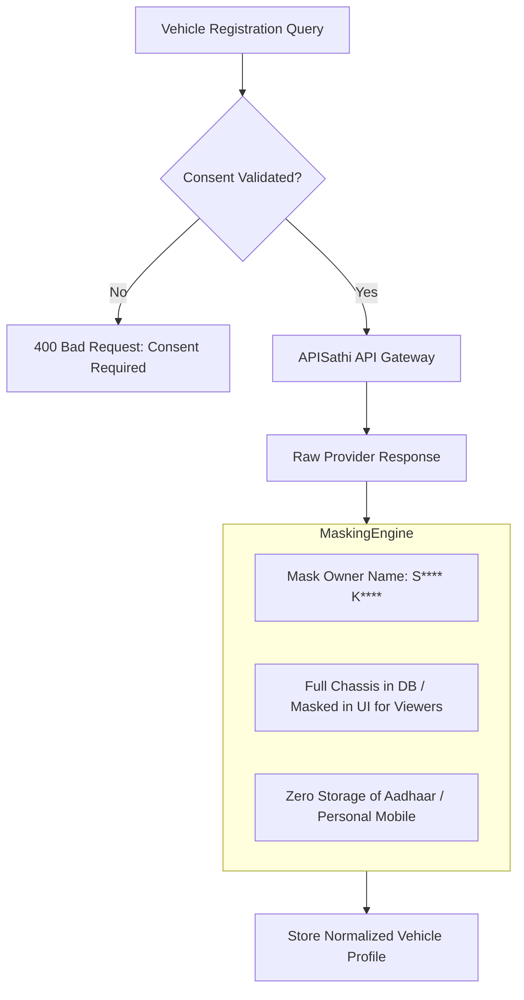
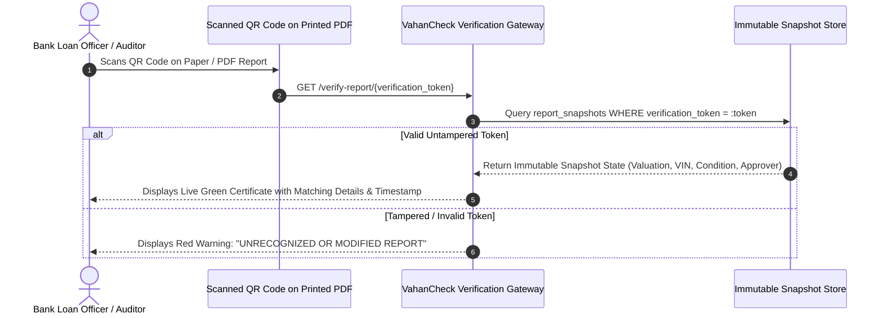

# Security, Privacy & Regulatory Compliance Architecture: VahanCheck Enterprise

## 1. Security Architecture Principles

VahanCheck Enterprise processes sensitive asset ownership, banking hypothecation records, geo-located field photographs, and valuation certificates. Security is designed into the core system architecture under the following zero-trust principles:

1. **Principle of Least Privilege (PoLP)**: Every service, background worker, and user account operates with minimum essential database and API permissions.
2. **Defense in Depth**: Security controls operate across network edges, application gateways, database rows, and storage buckets.
3. **Immutability & Non-Repudiation**: Finalized inspection snapshots, financial ledger entries, and audit logs cannot be updated or deleted.
4. **Zero Client Secrets**: Third-party API keys (APISathi, Firebase, AWS S3) are held strictly in backend environment secrets and never transmitted to browser or mobile clients.
5. **No Portal Scraping**: Complete adherence to authorized B2B provider APIs. Strict prohibition against web scraping, automated CAPTCHA bypassing, or spoofing government Parivahan endpoints.

---

## 2. Multi-Tenant Segregation & Boundary Enforcement

Data leakage between competing inspection agencies, surveyor firms, or financial institutions constitutes a catastrophic failure.

### 2.1 Database Row-Level Security & Global Scopes
- Every tenant model inherits from `TenantModelTrait`, automatically applying a global scope:
  ```php
  static::addGlobalScope('organization', function (Builder $builder) {
      if (auth()->check() && !auth()->user()->isSuperAdmin()) {
          $builder->where('organization_id', auth()->user()->organization_id);
      }
  });
  ```
- Any manual raw SQL query must include explicit `organization_id = :org_id` parameter binding.
- All composite unique constraints pair tenant keys (e.g. `UNIQUE(organization_id, code)`).

### 2.2 Storage Segregation
- S3 bucket policies enforce path partitioning:
  `arn:aws:s3:::vahan-storage/{organization_id}/*`
- Direct S3 public read is permanently disabled (`BlockPublicAcls = true`, `IgnorePublicAcls = true`, `BlockPublicPolicy = true`, `RestrictPublicBuckets = true`).
- File retrieval requires backend-generated Pre-Signed URLs valid for a maximum of 900 seconds (15 minutes).

---

## 3. Authentication, Tokens & Session Security

### 3.1 Laravel Sanctum Token Hardening
- Sanctum personal access tokens are stored in the database as SHA-256 hashes.
- Tokens enforce strict maximum lifetimes (e.g., 7 days for mobile field devices, 12 hours for web portal sessions).
- Token abilities are strictly evaluated:
  `$user->createToken('mobile_app', ['inspections:read', 'inspections:write'])`
- **Device Fingerprint Binding**: Mobile logins record unique device identifiers (`device_id`). If a token is presented from a different device fingerprint or invalid user-agent family, it is immediately revoked.

### 3.2 Password & Credential Hashing
- User passwords are encrypted using **Argon2id** (`memory_cost = 65536`, `time_cost = 4`, `threads = 1`).
- Multi-factor authentication (MFA) readiness via TOTP (RFC 6238) for Valuers, Admins, and Approvers.

---

## 4. Data Protection & Privacy Compliance (DPDP Act 2023)

The platform complies with India's **Digital Personal Data Protection Act, 2023 (DPDP Act)** and relevant provisions of the **Information Technology Act, 2000**.



### 4.1 Masking & Personal Identifiable Information (PII) Policies
1. **Owner Names**: Vehicle owner names returned by registry providers must be masked before display in client interfaces and public reports (e.g., `M**** S**** LOGISTICS`). Full names are visible only to authorized bank underwriters verifying legal loan documents.
2. **Exclusion of Aadhaar & PAN**: The platform does not store or process citizen Aadhaar numbers or personal tax identifiers from vehicle registration data.
3. **Purpose-Based Consent**: Vehicle verification requests mandate a `consent_obtained: true` flag affirming that the inquiry is conducted for legitimate credit assessment, insurance underwriting, or authorized fleet inspection.
4. **Data Retention & Right to Erasure**: Organizations can configure automated data retention policies (e.g., purge raw provider JSON after 180 days; archive immutable inspection snapshots for 7 years as required by banking regulations).

---

## 5. Media & Evidence Upload Hardening

Attackers frequently use image upload endpoints to deliver web shells, malicious scripts, or corrupted EXIF payloads.

### 5.1 Validation & Conversion Pipeline
1. **Content-Type & Magic Byte Verification**: File headers are validated against binary signatures (`image/jpeg`, `image/png`, `image/webp`). Executable file extensions (`.php`, `.exe`, `.sh`, `.svg`, `.html`) are strictly rejected.
2. **Automated Conversion to WebP**: All uploaded inspection photos are re-encoded into optimized WebP format on secure background workers. This process strips any embedded executable metadata or exploit payloads while preserving valid GPS EXIF coordinates.
3. **Cryptographic Integrity**: The SHA-256 hash of each uploaded image is computed and stored. Any modification of the stored artifact triggers an immediate tamper flag.

---

## 6. Report Tampering Prevention & QR Verification

Inspection reports are legal documents used to disburse multi-crore vehicle loans. Preventing fraudulent alterations is paramount.



### Security Measures:
- **Verification URL**: Each PDF embeds a high-contrast QR code resolving to `https://app.vahancheck.com/verify-report/{token}`.
- **SHA-256 Snapshot Freeze**: The exact JSON representation of the inspection, tyre metrics, challan summary, and valuation numbers is cryptographically hashed at the moment of approval.
- **Mock Data Watermarking**: Any report containing simulated or mock provider data is permanently stamped with a prominent semi-transparent diagonal red watermark across all pages:
  `DEMONSTRATION DATA — NOT FOR OFFICIAL USE`.

---

## 7. Rate Limiting, Abuse Prevention & Network Hardening

1. **Redis Token-Bucket Rate Limiting**:
   - `auth/*`: 5 attempts per minute per IP.
   - `vehicles/lookup`: 30 queries per minute per organization (burst 60).
   - `inspections/evidence/*`: 120 uploads per minute per inspector.
2. **Circuit Breaker**: Detects provider degradations and cuts off calls after 5 consecutive failures, avoiding rapid financial credit drain.
3. **Audit Logging**: All sensitive mutations (valuation adjustments, report generation, user permission elevation) write immutable records to `audit_logs` containing actor ID, IP address, user-agent, timestamp, and JSON before/after state diffs.
