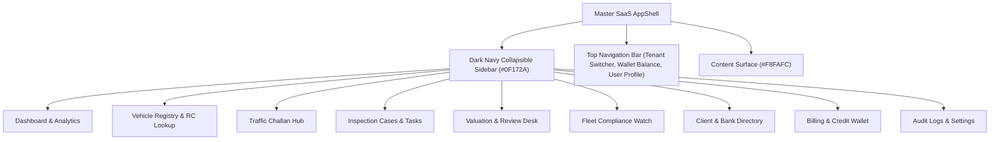
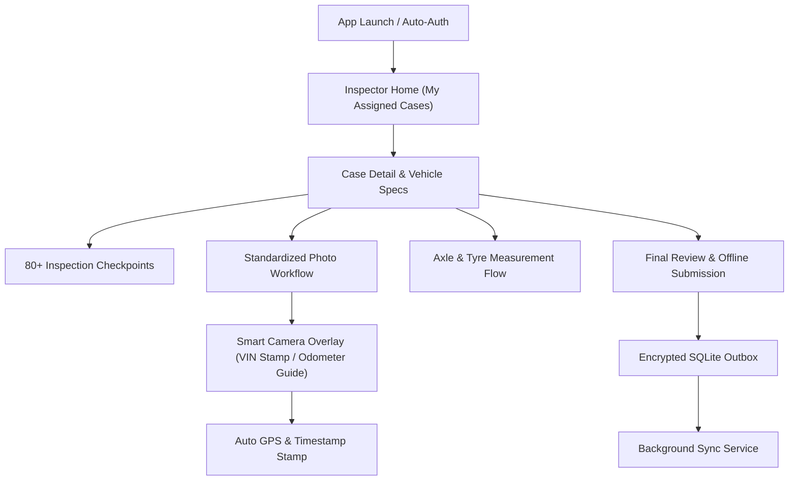

# UI/UX Specification & Design System: VahanCheck Enterprise

## 1. Design System & Visual Language

VahanCheck Enterprise delivers a modern SaaS interface built for intensive operational use by banking credit managers, valuation heads, and field surveyors. The interface combines maximum information density with clean visual hierarchy, accessibility, and high contrast.

### 1.1 Color Palette & Design Tokens

```
/* Primary Theme Color Variables */
:root {
  /* Surfaces & Structural */
  --sidebar-bg: #0F172A;          /* Slate 900: Dark Navy Navigation */
  --sidebar-hover: #1E293B;       /* Slate 800: Active / Hover Item */
  --sidebar-text: #94A3B8;        /* Slate 400: Inactive Nav Label */
  --sidebar-text-active: #FFFFFF; /* Pure White */
  --canvas-bg: #F8FAFC;           /* Slate 50: Clean Canvas Background */
  --surface-card: #FFFFFF;        /* Pure White Card Background */
  --border-subtle: #E2E8F0;       /* Slate 200: Subtle Card/Table Borders */
  
  /* Brand & Action Colors */
  --primary-blue: #2563EB;        /* Blue 600: Primary CTAs, Active States */
  --primary-hover: #1D4ED8;       /* Blue 700: Button Hover States */
  --primary-subtle: #EFF6FF;      /* Blue 50: Active Tab & Highlight Backgrounds */
  
  /* Semantic Status Indicators */
  --teal-success: #0D9488;        /* Teal 600: Approved, Pass, Clean Blacklist */
  --teal-subtle: #F0FDFA;         /* Teal 50: Success Tag Background */
  --amber-warning: #D97706;       /* Amber 600: Attention Needed, Disposed Challan */
  --amber-subtle: #FFFBEB;        /* Amber 50: Warning Tag Background */
  --red-alert: #DC2626;           /* Red 600: Fail, Blacklisted, Pending Challans */
  --red-subtle: #FEF2F2;          /* Red 50: Danger Tag Background */

  /* Typography */
  --font-sans: "Inter", -apple-system, BlinkMacSystemFont, "Segoe UI", Roboto, sans-serif;
  --font-mono: "JetBrains Mono", "SF Mono", Menlo, monospace;
}
```

---

## 2. Web Application Interface Architecture (Next.js)



### 2.1 Navigation & Workspace Layout
- **Sidebar Navigation**: Fixed left-hand 260px dark navy container (`#0F172A`). Collapses into an icon-only 68px bar on tablet breakpoints.
- **Top Bar**: Houses the active Branch selector, Real-time Credit Balance pill (`₹14,250 / 950 Credits`), Quick Search bar (`Ctrl + K` or `Cmd + K` for instant vehicle plate lookup), Notification Bell with unread count, and User Profile avatar dropdown.
- **Content Area**: Fluid auto-padding (`p-6` to `p-8`) with standardized breadcrumb trails, page header titles, action button bars, and responsive CSS grid wrappers.

### 2.2 Core Web UI Views & Components

1. **Global Vehicle Lookup & Profile Modal**:
   - Hero search bar with automated license plate format auto-capitalization (e.g., `MH 12 AB 1234`).
   - Quick-toggle for "Obtained Customer Consent" before lookup execution.
   - Profile view features categorized tabs:
     * *Identity & Specifications*: Engine/Chassis stamping, fuel, cubic capacity, unladen/gross weights.
     * *Registration & Ownership*: Masked owner name, registration sequence, RTO, RC validity status.
     * *Hypothecation & Insurance*: Bank financier details, insurer, policy validity badge.
     * *Compliance Validities*: Expiry timeline progress bars (Fitness, Tax, PUCC, Permits).
     * *Traffic Violations*: Tabular breakdown of pending vs disposed fines with direct Parivahan link.

2. **Inspection Case Desk & Task Board**:
   - Filterable Data Table (TanStack Table) with server-side pagination, status chips (`DRAFT`, `ASSIGNED`, `IN_PROGRESS`, `SUBMITTED`, `APPROVED`), date range pickers, and inspector filter.
   - Bulk action toolbar for assigning multiple cases to field inspectors.

3. **Valuation & Quality Control Review Desk**:
   - Side-by-side inspection view: Checklist ratings and captured photo evidence on the left; automated valuation calculator on the right.
   - Interactive override sliders with instant recalculation of Fair Market Value and Distress Value.
   - Valuer Digital Signature Box with mandatory written justification input before approval is unlocked.

4. **Interactive Multi-Axle Tyre Visualizer**:
   - Dynamic SVG vehicle chassis rendering depicting 2-axle, 3-axle, or multi-axle configurations.
   - Color-coded tyre nodes (Green = >70% tread, Yellow = 40-70%, Red = <40% worn out). Clicking a wheel opens the tyre spec sheet with captured photo preview and tread depth gauge.

5. **Billing & Credit Wallet Management**:
   - Wallet card displaying current credit balance and average monthly burn rate.
   - One-click credit pack purchase with integrated Razorpay/Stripe checkout.
   - Downloadable GST tax invoices with itemized ledger breakdowns.

---

## 3. Mobile Application Interface Architecture (Flutter Android)

The Android application is tailored for field inspectors operating in harsh physical environments (bright outdoor sunlight, greasy hands, vehicle pits).

### 3.1 Field-Optimized UX Principles
- **High Contrast Theme**: High-contrast typography and prominent iconography visible under direct midday sunlight.
- **Large Touch Targets**: Minimum 48x48 dp touch target dimensions across all interactive buttons, radios, and checklist triggers.
- **Haptic & Audio Feedback**: Tactile vibration upon successful photo capture, barcode scan, or offline checkpoint save.
- **Persistent Connectivity Pill**: Persistent status banner:
  * Green: *Online - Connected*
  * Amber: *Offline - 4 items queued in local storage*
  * Blue: *Syncing 14 photos (65%)...*



### 3.2 Mobile Screens & Interaction Workflows

1. **Inspector Case List**:
   - Grouped by *Scheduled Today*, *Pending Sync*, and *Completed*.
   - Quick navigation button to launch Google Maps with turn-by-turn directions to inspection address.
2. **Standardized Camera Capture Experience**:
   - Semi-transparent silhouette overlays guiding the inspector to frame the vehicle correctly (e.g. Front 45° angle, Odometer frame, Chassis stamping plate).
   - Real-time GPS coordinate lock indicator ensuring photo geo-metadata meets audit standards before shutter trigger.
3. **Streamlined Checkpoint Evaluation**:
   - Categorized segmented pills: *Pass*, *Attention*, *Fail*, *N/A*.
   - Voice-to-text integration for quick recording of inspector mechanical remarks.
4. **Offline Sync Center**:
   - Visual progress bar showing pending payload queue and active upload speed.
   - Manual "Sync Now" button alongside automatic network-aware background synchronization.
